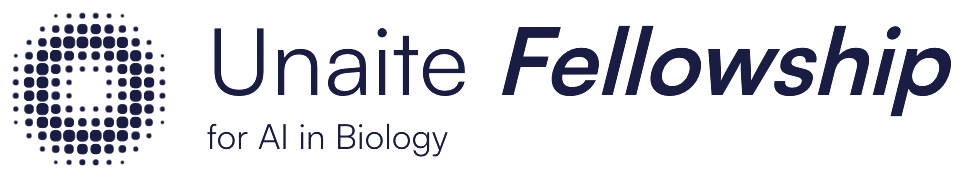
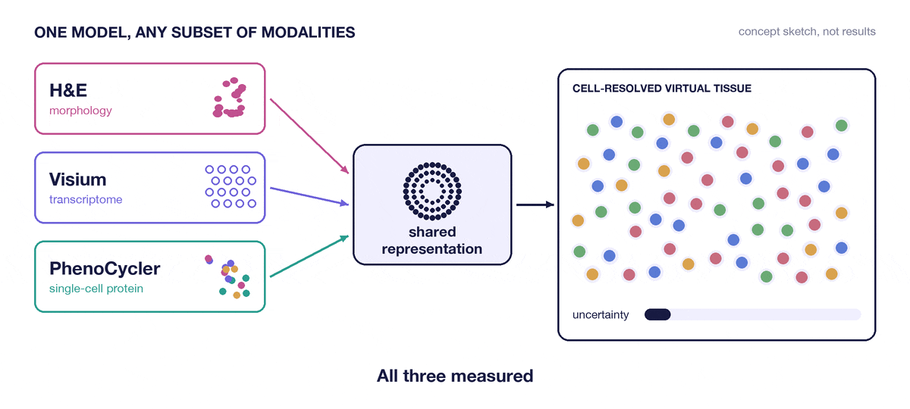

  <picture>
    <source media="(prefers-color-scheme: dark)" srcset="assets/readme/unaite-logo-reversed.png">
    
  </picture>

<h1 align="center">Virtual Tissue</h1>

<i>rebuild the tissue, cell by cell, from whatever was measured</i>

  One model that takes whichever of <b>H&amp;E</b>, <b>Visium</b> and <b>PhenoCycler</b> exist for a sample 
  and reconstructs a <b>cell-resolved map of the tissue</b>: what each cell is, what state it is in, 
  where it sits, and <b>how sure</b> the model is about each of those, even when a measurement is missing.

  <b>Unaite Fellowship for AI in Biology</b> &nbsp;·&nbsp; Inaugural cohort, Paris &nbsp;·&nbsp; 2026-27

  <a href="https://fellowship.unaite.fr"><b>◆ The Unaite Fellowship&nbsp;→</b></a>
  &nbsp;&nbsp;·&nbsp;&nbsp;
  <a href="#the-project-brief">The brief</a>
  &nbsp;&nbsp;·&nbsp;&nbsp;
  <a href="#team">Team</a>

  
  

  

---

## What is this, in plain terms?

A pathology lab can look at the same piece of tumour in several ways. An **H&E** slide shows the
shape of every cell and how the tissue is built. **Visium** reads out which genes are switched on,
but in spots that each hold several cells at once. **PhenoCycler** measures dozens of proteins in
each individual cell, but only the proteins on its panel. Each one sees something the others
cannot, and almost no sample has all three.

This project builds one model that takes whichever of those measurements exist for a sample and
reconstructs a map of the tissue at the level of individual cells. When a measurement is missing,
the model should still work, and its uncertainty should widen honestly to match.

The reason it matters is that H&E is everywhere and the other two are rare and expensive. A model
that learns from the paired data and still behaves sensibly on H&E alone is a model a hospital
could actually run.

---

## The three measurements

| | What it measures | Resolution | What it cannot see |
|---|---|---|---|
| **H&E** | tissue morphology | single cell, by shape | any molecule directly |
| **Visium** | the whole transcriptome | spots holding several cells | which cell in a spot said what |
| **PhenoCycler** | multiplexed protein imaging | single cell | anything not on the antibody panel |

---

## The project brief

The project as set by our mentors: build an **interpretable** model for a cell-resolved
"virtual tissue" from **incomplete** spatial multi-omics.

**The data science challenges**

- Learn across different spatial resolutions.
- Handle modalities that are strongly paired, on adjacent sections, or missing altogether.
- Quantify the uncertainty of every reconstruction.

**Methods named in the brief**

- Cross-modal and contrastive representation learning.
- Morphology-guided deconvolution.
- Optimal transport or graph-based spatial alignment.

**How we will know it works**

- Accurate recovery of cell type and cell state.
- Generalisation when one modality is absent.
- Validation against same-section PhenoCycler ground truth.

**The deliverable:** a reusable multimodal model that turns sparse, heterogeneous measurements
into a unified cellular map of the tumour microenvironment.

---

## Team

**Mentors**

| | Role | Area |
|---|---|---|
| Jérémie Kalfon | main mentor | single-cell foundation models |
| Cécile Badoual | mentor | pathology, Gustave Roussy |
| Quentin Garrido | mentor | representation learning, AMI Labs |

**Fellows**

Gary Klajer · Christian Langridge · Faith Ogundimu · Amine Ould · Raphaël Rubrice

---

  Part of the <a href="https://fellowship.unaite.fr">Unaite Fellowship for AI in Biology</a> &nbsp;·&nbsp; Paris, 2026-27

test
