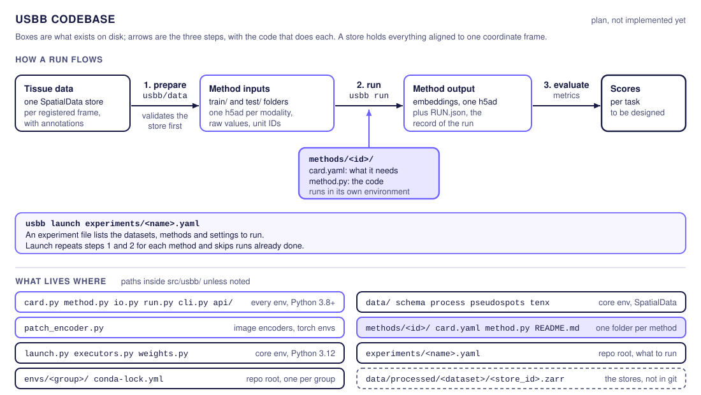

# USBB codebase

*The reasons behind each choice, and the evidence, are in [wrappers.md](wrappers.md).*

USBB (Unaite Spatial Biology Benchmark) is the code that runs every method of our benchmark (encoders, baselines, fusion and integration methods) the same way, on the same data, and keeps a record of each run. Evaluation is a separate layer that reads the results.



## How a run flows

Tissue data is kept in **SpatialData stores, one per registered coordinate frame**. Each measurement (an H&E scan, a PhenoCycler image, Visium spots) comes with its own positions. Registration aligns them as closely as it can, so that the same point of tissue gets about the same coordinates, in µm, in every measurement. Alignment is never perfect: the remaining error is recorded in the store, and neighbouring sections never share the same cells. A store holds everything aligned into one such frame, with its annotations, and is read-only once written. In practice:

- One Visium section with its H&E, and its protein if measured on the same section: one store.
- Two neighbouring sections, once one is registered onto the other (as for Causer's PhenoCycler section and its Visium and H&E section): one store, recorded as adjacent sections.
- One tissue microarray slide with all its cores (as for Haist): one store, with each cell's core recorded.
- Measurements never aligned to each other (separate sections, separate slides): separate stores.

Every spot and cell also records its section, sample and patient, so data can be split by patient or by core whatever the store.

Then three steps:

1. **Prepare** (`usbb/data/`). Validates the store, then writes the method's inputs: a `train/` and a `test/` folder with one h5ad file per modality, raw values and unit IDs. H&E arrives as patches already cut at the method's resolution.
2. **Run** (`usbb run`). Runs one method in its own environment. It writes one output h5ad, with one embedding per named latent, then `RUN.json`, the record of how the result was made.
3. **Evaluate** (separate layer, to be designed). Reads outputs and method cards, never method code, and writes scores.

**Experiment files** say what to run. `usbb launch experiments/<name>.yaml` repeats steps 1 and 2 for every method in the file and skips runs already done:

```yaml
dataset: data/processed/tenx_tonsil/   # a folder with one store per frame
unit: spot
methods:
  - phikon_v2
  - hvg_pca: {n_components: 50}
  - concat: {inputs: [phikon_v2, hvg_pca]}
```

The work runs on the local machine or on a computing cluster.

## Five ideas (see [wrappers.md](wrappers.md))

- **Method card** (`card.yaml`): what a method takes and gives, its fit mode, its environment, its held-out status, and for pretrained models the pinned weights and their hash. Listing methods reads only the cards.
- **Method** (`method.py`): `load`, `fit` and `transform`, plus `check` for extra refusals. Image encoders build on `PatchEncoder` and write only `embed(patches)`.
- **Fit modes**: *frozen* methods learn nothing; *fitted* methods learn on the training data only; *transductive* methods fit on the test data without labels, and every result says so.
- **IDs, never row order**: every row of every file carries its unit ID (`<store_id>:<instance_id>`), so results from different methods join safely.
- **Run key**: a hash of the method's code and card, its settings and seed, its input data, its weights and its environment. If any of them changes, the run is redone; otherwise it is reused.

## Where things live

| Path | What |
|---|---|
| `src/usbb/` card, method, io, run, cli | the core, imported in every method environment (Python 3.8+) |
| `src/usbb/launch.py`, `executors.py`, `weights.py` | running experiment files, fetching pinned weights |
| `src/usbb/data/` | data schema, validation, pseudospots, readers, step 1 |
| `data/processed/<dataset>/<store_id>.zarr` | the stores, one per registered frame (not in git) |
| `src/usbb/methods/<id>/` | one folder per method: `card.yaml`, `method.py`, `README.md` (its guide), test |
| `envs/<group>/` | one locked conda environment per group of compatible methods, with the reason for each |
| `experiments/` | experiment files: what to run on which data |

## Adding a method

1. Take the method's issue on GitHub and read its guide in `src/usbb/methods/<id>/README.md`.
2. Write `card.yaml`: inputs and outputs, fit mode, environment group; for a pretrained model, the pinned weights.
3. Write `method.py`, starting from the closest example in the table below.
4. Reuse an environment group, or add one with the reason the method cannot share.
5. Run its contract test: `pytest tests/test_contract.py -k <id>` (a method with pinned weights also has its own test in its folder).
6. Open the pull request and tick its "Adding a method" checklist.

| Kind of method | Examples from our list | What to write | Start from |
|---|---|---|---|
| Pretrained H&E encoder | UNI, Virchow2, CONCH, H-optimus | `load` and `embed(patches)`; pin the weights | `phikon_v2` |
| Pretrained RNA or protein encoder | scGPT, Geneformer, UCE, KRONOS2, VirTues | `load` and `transform`; pin the weights; map our genes or markers to the model's vocabulary | the first one written |
| Baseline fitted on our data | highly variable genes + PCA, mean marker intensity, astir | `fit` and `transform`, no weights | `hvg_pca`, `mean_intensity` |
| Fusion or integration | concatenation, SpatialGlue, MISO, MOFA+, COSIE | inputs are other methods' outputs or several modalities; often transductive | `concat` |
| Control | random features | a method marked `control: true` | `random_features` |
| Translator or matcher | ROSIE, GigaTIME, MIPHEI-ViT; MaxFuse | outputs are predicted markers or cell-to-spot links | not designed yet |

Methods with old dependencies (SpatialGlue pins Python 3.8) get their own environment group. Methods written in R (Seurat WNN) are not covered yet.

## House rules for code

- Simple first: the fewest files, classes and options that do the job.
- No option or layer without a current use.
- Names explain; comments only say why, never what.
- Fail loudly, with every problem listed in one error.
- Short files: anyone should be able to read a method in two minutes.

## Open Problems

[Open Problems](https://openproblems.bio) is a community benchmarking platform. Each of its benchmarks is built from fixed kinds of steps with fixed input and output files. We follow the same structure, without its tooling for now, so each of our steps can become an Open Problems component later:

| Ours | Open Problems name |
|---|---|
| Tissue store | dataset |
| 1. Prepare | data processor |
| 2. Run | method (control method for controls) |
| Method output | method output |
| 3. Evaluate | metric |

## Decided and still open

Decided on 23 November:
- SpatialData stores, one per registered coordinate frame (defined above).
- h5ad files between steps.
- Method side on Python 3.8+, core on Python 3.12.
- One conda-lock environment per group of compatible methods.
- The Open Problems structure, without Open Problems tooling yet.

Still open:
- How pseudospots aggregate cells.
- Protein image methods at cell scale.
- Splits, metrics and controls (evaluation layer).
- Output format for translators and matchers.
- How methods written in R plug in.
- The full-resolution tonsil H&E image (download pending).
- Who implements which methods.

## Order of work

Ten small pull requests build the core, the data preparation, four reference methods, the launcher, the contribution docs and the Phikon-v2 example. Methods are split once:
- CI is green.
- A tonsil run has completed on the cluster, and a rerun comes entirely from cache.
- Phikon-v2 gives the same embeddings as its official code.
- Every v0 and Tier 1 method has a guide and an issue.
