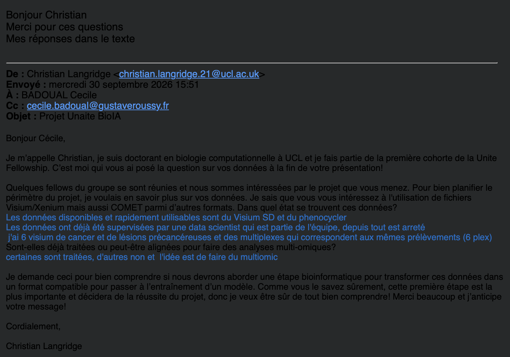

# Project Proposal: A Held-Out Benchmark of Pretrained Encoders for Same-Section PhenoCycler + H&E + Visium Data

**Status:** Draft for team review
**Date:** 27 October 2026
**Team:** Gary Klajer, Christian Langridge, Faith Ogundimu, Amine Ould, Raphaël Rubrice
**Planned duration:** 9 months

---

## 1. Context

Pretrained encoders for spatial biology now exist for every modality we care about: pathology foundation models for H&E, expression foundation models for spatial transcriptomics, and newer foundation models for multiplexed protein imaging. Each has mostly been evaluated on its own terms, on data that overlaps with what it was trained or validated on, and almost always on one or two modalities at a time.

We propose a systematic, reproducible audit of pretrained encoding strategies for **H&E histology, 10x Visium spatial transcriptomics and PhenoCycler multiplexed protein imaging**, evaluated together on a **shared, held-out dataset that none of the tools have seen**. The anchor dataset is same-section PhenoCycler + Visium + H&E data from the Badoual Lab (HEGP, Paris),

**From reading Badoual Lab research and data described in bioRxiv [10.1101/2024.10.03.616510](https://www.biorxiv.org/content/10.1101/2024.10.03.616510v1)**: **Biological question.** In this HPV-positive head and neck tumour, the source study found two places where Visium RNA misrepresents the protein-level tissue: PD-L1 protein appeared more localised and intense than its *CD274* RNA signal, and Tregs and B cells were described as rarely being the dominant cell type in a Visium spot. Both are qualitative observations that we will first quantify. Same-section PhenoCycler gives single-cell protein ground truth for both. We ask: We ask: **can pretrained encoding and integration strategies recover protein-level truth where RNA fails, and do their latent spaces represent these modality mismatches as distinct biological features or just average them out?**

The project has two central aims to answer this :

- **Aim 1: Measure integration quality.** Define and apply metrics that quantify how well each strategy integrates the three modalities: what information is shared across modalities (overlap), what is lost or left modality-specific (underlap), and whether integration wrongly forces agreement where the biology genuinely disagrees.

- **Aim 2: Test what biology the latent spaces captured.** Use interpretability methods (concept probes, sparse autoencoders, concept erasure and, where models have decoders, intervention) to ask whether encoder and integration latents represent the biological relationships already established for this dataset in the literature.

The deliverable is an open benchmark to be confirmed but could include:

- **Infrastructure in our Github**: data loaders, a fixed evaluation protocol, integration metrics, an interpretability toolkit,

- **Results**: results for every encoder and fusion strategy, and a write-up.

---

## 2. Motivation and gap

### 2.1 What already exists

| Benchmark / study | Modalities | What it compares | What it lacks for our question |
|---|---|---|---|
| HEST-1k / HEST-Benchmark (Jaume et al., NeurIPS 2024) | H&E + ST | Pathology patch encoders for predicting gene expression (10 in the paper, ~25 on the current leaderboard) | No protein modality; no fusion |
| HESCAPE (Gindra et al., arXiv 2025) | H&E + ST | Contrastive pretraining with 5 image × 4 gene encoders | No protein; batch effects limit alignment |
| STP-BENCH (Chung et al., arXiv 2026) | H&E + Visium/Xenium | 21 virtual-ST methods; 5 image encoders under a controlled setting | No protein; shows encoder choice reorders method rankings |
| PhenoBench / PathoCellBench (MICCAI 2025) | H&E, with CODEX-derived labels | Pathology encoders for cell phenotyping | No ST; protein used only as labels, not as an encoded modality |
| Training-free probe audit (Bhattacharjee et al., arXiv 2026) | H&E + ST | 5 frozen pathology encoders, with shortcut and shift controls | No protein |
| scFM benchmarks (e.g. Hou et al., bioRxiv 2026) | scRNA-seq | 13 single-cell foundation models vs classical baselines | Not spatial; finds PCA often competitive |
| KRONOS (Shaban et al., arXiv 2025) | Multiplexed protein | Introduces a spatial proteomics encoder | Not an independent benchmark |
| Eva (Liu et al., bioRxiv 2026; Enable Medicine, Stanford, HKU) | Multiplexed protein + H&E (H&E as extra input channels) | Joint MIF/H&E masked autoencoder vs VirTues, KRONOS (protein), ROSIE, GigaTIME (H&E→MIF), UNI, Prov-GigaPath (H&E) | No transcriptomics; developer-run evaluation with random 8:1:1 splits; authors note no gold-standard dataset exists for objective comparison |
| COSIE (Li et al., bioRxiv 2026) | H&E, Visium HD, PhenoCycler/CODEX and others | One integration framework vs StabMap and SpaMosaic | Not an encoder audit; modalities split across adjacent sections |
| Ren et al. (Nat Commun 2025, SPATCH) | Visium HD and 3 other ST platforms + adjacent CODEX + H&E | Assay platforms | Compares measurement technologies, not encoders |
| spora / spora [bench] (von Querfurth, Wenckstern et al., NeurIPS 2026 E&D; Bunne Lab, EPFL) | Multiplexed protein (IF, Orion, IMC, CODEX, MIBI), with paired H&E for ~31% of tiles | VirTues, KRONOS, Eva vs baselines; H&E→protein translators (ROSIE, HistoPlexer, GigaTIME); 6 tasks from subcellular to patient level | No transcriptomics; no fusion beyond H&E→protein; built by the group that developed VirTues, so not fully independent |
| spEMO (Liu T. et al., Nat Biomed Eng 2026) | H&E + ST, and spatial RNA + protein (sequencing-based) | Pathology FM (and LLM) embeddings fused with omics; adds a multi-modal alignment task for pathology FMs | Developer-run; no protein imaging encoder; no tri-modal same-section setting |
| SpaMBench (2026, GitHub/Zenodo) | Spatial RNA + protein (ADT) and RNA + ATAC | 18 spatial multi-omics integration methods on 16 datasets, with masking/noise/coordinate perturbations | No H&E; no pretrained encoders; protein is spot-level ADT, not imaging |
| Liu C. et al. (Nat Methods 2025) | Single-cell RNA, ADT, ATAC (+ spatial registration) | 40 integration methods across vertical, diagonal, mosaic and cross integration | Not spatial imaging; no H&E; no encoders |

### 2.2 The gap

We found no published study that holds the specimens, spatial units, probes and splits constant while varying **pretrained encoders and fusion strategies across all three modalities**. We also found none that does so on **same-section** tri-modal data held out from all tools' training and validation. Two independent literature sweeps (manual, and an Edison agent search) reached the same conclusion. Worth rechecking independently again as this is a literature-search finding, not proof of absence. A third check (30 Oct 2026) adding spora/spora [bench], spEMO, SpaMBench and the Liu et al. (2025) integration benchmark did not change this: each covers at most two of our three modalities, or covers integration methods without pretrained encoders.

### 2.3 Why it benchmark matters

- **Encoder choice is a hidden confound.** STP-BENCH found that standardising the image encoder substantially changed rankings of downstream methods.
- **Simple baselines are often competitive.** PCA remains competitive with single-cell foundation models in some settings (Hou et al., 2026).
- **Rankings depend on the metric.** PathScaleBench (2026) found no pathology encoder dominated every evaluation dimension.
- **Adjacent sections differ measurably.** In the Badoual dataset, same-section and consecutive Visium sections shared ~75% of their top 3,000 highly variable genes, with differences concentrated in tumour spots; the authors attribute this to using consecutive sections (Badoual preprint). Adjacent-section collection introduces spatial misalignment that complicates cell-to-cell comparison [Tran et al., 2025](https://www.frontiersin.org/journals/molecular-biosciences/articles/10.3389/fmolb.2025.1614288/full), and perfect concordance between sections is described as almost unattainable [DBiTplus, 2024](https://www.nature.com/articles/s41592-025-02948-0). *Our hypothesis*, tested by the same- vs adjacent-section calibration, is that some apparent encoder or integration errors on adjacent-section data reflect these section differences rather than representation quality.
- **Developer-run evaluations have acknowledged limits.** Eva's authors note restricted availability of out-of-distribution datasets, that their expert-curated downstream labels could bias evaluation, and that a gold-standard dataset would enable more objective comparison. 29% of their validation regions were also seen during pretraining [Liu et al., 2026(https://www.biorxiv.org/content/10.64898/2025.12.10.693553v2.full). An independent, held-out benchmark addresses these limits directly.

### 2.4 The biological question comes from the data

The question is grounded in two observations the source study made in this exact dataset. Because protein was measured on the same section, both have direct ground truth.

**Q1. RNA–protein discordance.** PD-L1 protein (PhenoCycler) appeared more localised and intense than *CD274* RNA (Visium) (Fig 3 - Badoual paper). Podoplanin, TCF-1 and CD14 showed concordant RNA and protein patterns (Fig 3 - Badoual paper). PD-L1 matters clinically: it is the main biomarker for anti-PD-1/PD-L1 therapy. The index patient did not respond to nivolumab; with one patient, this is context, not an outcome we can model.

**Q2. Immune populations that do not dominate Visium spots.** In the text accompanying Figure 3c, the authors state that Tregs and B cells, which they describe as typically sparsely distributed, were rarely the dominant cell type in any single Visium spot and were therefore hard to distinguish in Visium. This is a qualitative statement, not a measured result: the paper reports overall PhenoCycler cell-type proportions (Fig. 2d) and maps of the most frequent cell type per pseudospot (Fig. 3c), but no per-spot fractions and no per-technique proportions. Fig. 2d also describes Tregs as significantly present overall, so the issue is spatial dispersion relative to 55 µm spots, not low overall abundance.

**Q2 is therefore conditional.** Its first deliverable is to quantify per-spot Treg and B-cell fractions from PhenoCycler pseudospots. Q2 proceeds only if that shows enough spots where these populations are present but sub-dominant.

Both are cases where a model that simply aligns modalities could look good while losing exactly the biology that matters. That makes them strong tests of encoder and integration quality.

---

## 3. Data

### 3.1 Anchor dataset: Badoual Lab same-section HNSCC

**Sourcing**
- TBC

**My interpretation thus far based on Cécile's response**

**Implications so far from our understanding**
- **Processing becomes part of the project.** Segmentation, registration and QC for the unprocessed samples fall to us. These choices must be standardised and documented, because they affect every downstream encoder.
- **Unprocessed data is good for the held-out premise.** It makes prior use in any model's training less likely, though the Enable Medicine question still applies to any samples already processed on that platform.
- **A cancer vs precancer axis is a new biological dimension.** Whether PD-L1 discordance and spatially dispersed immune populations differ between precancerous lesions and cancer extends Q1 and Q2 naturally. With 6 samples this is descriptive, not a statistical comparison.
- **If the panel is 6-plex**, the Q1 discordance atlas shrinks to at most 6 markers, and Q2 is only feasible if the panel includes markers for Tregs (e.g. FOXP3, CD4) and B cells (e.g. CD20). Protein foundation encoders also need overlap with their pretraining marker vocabularies. The panel composition must be checked before the design is frozen.
**Why it suits our premise**
- True same-section alignment of all three modalities, plus a matched adjacent-section control.
- **Held-out status differs by modality.** The preprint's Visium data has been openly available on Zenodo since December 2024, so models released after that date could in principle have seen it; we must check public training corpora (e.g. HEST-1k sample lists) for these sample IDs. The PhenoCycler data does not appear in that record, and the remaining samples from the 6-sample cohort appear unreleased. The strongest held-out claims therefore attach to the protein modality and to the unreleased samples.
- The preprint documents biology we can use as tasks: RNA–protein discordance for PD-L1; Tregs and B cells described as resolved by PhenoCycler but rarely dominant in Visium spots; three malignant states. These observations are qualitative in the paper and will be quantified first.

**Known limitations**
- Very few patients and sections, so it is underpowered for generalisation claims on its own.
- The triple-assayed section shows a higher mitochondrial fraction, and only ~75% of top HVGs overlap with the ST-only section. This is an assay-induced shift.
- H&E is done after PhenoCycler cycling and may differ from routine H&E.
- HNSCC is represented in TCGA, which some pathology encoders were pretrained on. The patients are unseen; the tissue type may not be.
- **Possible Enable Medicine overlap (must resolve before data freeze).** The Badoual PhenoCycler data was processed on the Enable Medicine platform. Eva was co-developed by Enable Medicine and its training set includes PhenoCycler data from Enable's platform, plus unspecified "additional multiplexed images". We need written confirmation that the Badoual slides were not in Eva's training data. Separately, Eva's training data includes a head-and-neck cancer PhenoCycler cohort (UPMC-HNC, 43 markers), so Eva has seen this tissue type even if not these patients.
- **Possible spora overlap (check before data freeze).** spora includes head-and-neck multiplex cohorts. We should confirm none of them contains the Badoual or UPMC-HNC samples, and treat every spora cohort as potentially seen by VirTues (same group), KRONOS and Eva when interpreting protein-encoder results.

### 3.2 Supporting public data (for probe training and external comparison only)

- **HEST-1k**: paired H&E + ST, including Visium.
- **COSIE periodontal dataset**: H&E + Visium HD (section 1), PhenoCycler/CODEX + Visium HD (section 2).
- **SPATCH (Ren et al., 2025)**: Visium HD and other ST platforms with adjacent CODEX and annotated H&E.
- **spora (EPFL; [docs](https://spora.epfl.ch/docs/), [data](https://spora.bioimagearchive.org/))**: 13,546 standardised multiplex images from 5,477 patients, 35 cohorts, 14 tissue origins and 5 technologies (including CODEX), with paired H&E for ~31% of tiles, cell and tissue masks, cell types and marker-to-UniProt mapping. Uses for us: (a) large corpus for training protein- and H&E-side probes and SAEs; (b) `spora-io` marker harmonisation to map our PhenoCycler panel onto KRONOS/VirTues vocabularies; (c) `spora [bench]` task definitions (cell phenotyping, H&E→protein virtual staining) as a reference protocol so our protein-encoder numbers are comparable to theirs. Caveats: no transcriptomics; access is by credentials on request; `spora [bench]` code is CC BY-NC-ND 4.0 (we can run it but not redistribute modified versions, so our harness should reimplement any protocol we adapt); dataset licences vary per cohort.
- **10x Visium CytAssist Gene and Protein Expression (CC BY 4.0)**: same-spot whole-transcriptome RNA + ~35-antibody immune panel (sequencing-based ADT) + H&E on the same section, for tonsil, breast cancer and lymph node. This is the closest public analogue of our Q1 setting (RNA vs protein at the same Visium spot) and lets us replicate the discordance atlas in other tissues. Note: the human lymph node sections were used to develop SpatialGlue and several later integration methods, so they are not held out for those methods.
- **10x Xenium Protein (CC BY 4.0)**: same-cell RNA (~400 genes) + up to 27 proteins + post-Xenium H&E (e.g. renal cell carcinoma). Gives a single-cell, same-section tri-modal check for cell-level tasks (Q2 test 3).
- **UnumLocalia (bioRxiv 2026; Zenodo 21713660)**: Xenium 5k + COMET 16-plex protein + H&E on the same FFPE section, four TMA cores (HCC, non-tumour liver, tonsil, hepatocellular adenoma), with alignment matrices and per-cell RNA + protein quantifications. Small, but independently generated same-section tri-modal data released after most current encoders.
**Rule:** public data may be used to fit probes or heads. All headline results should be reported on the Badoual dataset.

---

## 4. Benchmark design

### 4.1 What varies

**(i) H&E image encoders** (initial candidates, to confirm in the inventory)
- Pathology foundation models: UNI / UNI2, CONCH, Virchow2, H-Optimus-0/1, Phikon / Phikon-v2, Prov-GigaPath, CTransPath
- Molecularly aligned pathology encoders (pathology FMs fine-tuned or pretrained with paired ST, sometimes protein): SEAL, H2O, STORM. Most were trained on HEST-1k, so check sample lists against the Badoual Visium release.
- Baselines: ImageNet ResNet50, handcrafted morphology features
**(ii) Visium RNA encoders**
- Baselines: log-normalised HVGs, PCA
- Foundation models: scGPT, Geneformer, UCE, CellPLM, Nicheformer, scGPT-spatial, Novae
**(iii) PhenoCycler protein encoders**
- Baselines: mean marker intensity per cell or pseudospot, PCA; cell-typing baselines used in spora [bench] (astir, MAPS)
- Foundation models: KRONOS (public weights; accepts only markers it was pretrained on, so panel coverage must be checked), VirTues (public weights; IMC-trained, uses ESM protein embeddings)
**(iv) Joint H&E + protein encoders**
- Eva (H&E fed as extra channels alongside MIF; public weights not confirmed in the preprint text, so check availability)
**(v) H&E → protein translators (as cross-modal baselines)**
- ROSIE, GigaTIME, MIPHEI-ViT (all have public weights or code)
- HistoPlexer (wrapped in spora [bench]; check weights and licence)
**(vi) Fusion strategies**
- Single-modality (each of the three)
- Pairwise (H&E+RNA, H&E+protein, RNA+protein)
- Tri-modal, with early fusion (concatenation), late fusion (prediction averaging) and cross-attention
- Learned integration methods, treated as fusion operators (see below). Existing reference points: COSIE, StabMap, SpaMosaic, HESCAPE-style contrastive alignment

*Why integration methods belong on the fusion axis.*
1. **They perform the same function.** An integration method takes per-modality features of the same spots or cells and returns one joint latent; so do our fusion strategies. Concatenation, averaging and cross-attention are the simplest members of this family (early, late and intermediate fusion). Integration methods are intermediate fusion with extra structure: spatial graphs, contrastive alignment, shared/private factorisation, or count-based noise models. Leaving them out would compare fused foundation-model embeddings only against naive fusion.
2. **They are compatible with holding encoders constant.** Most accept an arbitrary per-spot feature matrix (many default to PCA input), so they can run on top of each encoder's embeddings, giving an encoder × fuser grid. Methods that require raw counts (e.g. totalVI) are reported as end-to-end entries.
3. **Aim 1 cannot be answered without them.** Whether integration forces agreement where the biology disagrees depends on the integration objective. Contrastive alignment rewards shared information; methods with explicit shared and modality-specific latents (e.g. SpaMV) or a protein background model (totalVI) should treat PD-L1 discordance differently. Without this contrast we cannot tell whether lost discordance is due to the encoder or to the fusion design.
4. **They are the established baselines for fusion.** Just as PCA is the baseline for expression encoders (Hou et al., 2026), established integration methods are the baseline that a new fusion of foundation-model embeddings has to beat.
5. **They map onto our section design.** The integration literature's vertical (same section) vs diagonal/mosaic (different sections or partially missing modalities) categories (Liu C. et al., 2025) correspond to our same- vs adjacent-section calibration and to incomplete-modality settings, so methods built for each case give a natural reading of that comparison.

*Proposed scope* (each method must expose a joint latent usable by probes, SAEs and LEACE; methods that only output cluster labels are excluded; equal hyperparameter budget for all, since many defaults were tuned on the public lymph-node CytAssist data):
- **Tier 1 (distinct fusion principles):** SpatialGlue (graph + dual attention; developed on Visium RNA + protein, the closest setting to ours), MISO (adds histology features to omics and models pairwise interactions), SpaMV (explicit shared vs modality-specific latents, a direct test of underlap), totalVI (probabilistic RNA + protein model with protein background; non-spatial reference), MOFA+ / MEFISTO (linear factors with readable loadings, useful for Aim 2), Seurat WNN (per-spot modality weights; cheap and interpretable), SpaMosaic or COSIE (mosaic; needed for adjacent-section and missing-modality settings).
- **Tier 2 (if time allows):** GROVER (tri-modal including histology), spEMO, PHARAOH, COSMOS, PRAGA, SpaMode, StabMap, MultiVI, HESCAPE-style contrastive alignment.
- **Cell ↔ spot matching:** MaxFuse, designed for weak linkage (few, weakly correlated linked features), for matching PhenoCycler cells to Visium RNA. Weak RNA–protein linkage is exactly the PD-L1 situation.
### 4.2 What is held constant
- Specimens and registration
- Spatial units (Visium spot / pseudospot, and single cell where available)
- Probe type: linear/ridge, plus one non-linear probe (e.g. TabPFN or a small MLP)
- Embedding dimension control (PCA to a fixed dimension, as in HEST)
- Splits and random seeds

### 4.3 Aim 1: Integration quality metrics

*Proposal (to discuss).* All metrics are computed on each joint latent **and** on each unimodal latent, so every number has a unimodal reference. Unit: pseudospot by default, cell where available. We report each family separately rather than one aggregate score, since rankings depend on the metric (PathScaleBench).

**A. Overlap: what is shared across modalities**

| Metric | What it measures | Source |
|---|---|---|
| Linear CKA; mutual-kNN alignment | Similarity of representational geometry between unimodal latents | Kornblith et al., 2019; Huh et al., 2024 |
| FOSCTTM; cross-modal retrieval Recall@k | Whether a spot's representation in one modality finds the same spot in the other | Liu J. et al., 2019 (MMD-MA); HESCAPE |
| Cross-modal prediction R² (per feature) | How much of modality B is predictable from modality A's latent | HEST; Q1 test 1 |
| PID redundancy | Task-relevant information present in both modalities | Liang et al., 2023 |

**B. Underlap: what stays modality-specific or is lost**

| Metric | What it measures | Source |
|---|---|---|
| Retention ratio | Probe performance for modality-*m* targets from the joint latent, divided by performance from modality *m*'s own latent; < 1 means integration lost unimodal information | Ours |
| Neighbourhood preservation | Jaccard overlap between the joint kNN graph and each unimodal kNN graph | Standard in integration benchmarks |
| PID uniqueness and synergy; sample-wise interaction (LSMI) | Information held by only one modality, or only by their combination; LSMI localises it per spot, so it can be mapped on the tissue | Liang et al., 2023; LSMI (ICML 2025) |
| Modality reliance (perceptual score) | Performance drop when one modality's input is permuted across spots | Gat et al., 2021 |
| Shared vs private decomposition | Which concepts sit in shared vs modality-specific components | LatentVerse (arXiv 2026); SpaMV |

**C. Over-alignment: does integration force agreement where the biology disagrees?**
- **Discordance preservation score.** Q1 test 2 as a metric: probe performance separating discordant from concordant pseudospots in the joint latent, normalised by the best unimodal latent. Below 1 means integration averaged the discordance away.
- **Residual recovery.** Regress each protein on its RNA counterpart (and RNA neighbourhood); the residual is the RNA-unexplained protein signal. Report how well each latent predicts that residual. A latent that only aligns modalities should score near zero; one that keeps protein-specific information should approach the protein latent.
- **Alignment vs uniqueness plot.** Recent work finds that maximising cross-modal alignment helps when information is mostly redundant and hurts when it is mostly modality-specific (Tjandrasuwita et al., 2025; "To align or not to align", 2025). Plotting each method's alignment (CKA / mutual-kNN) against its retention and residual recovery flags over-aligning methods (high alignment, low retention).

**D. Conventional integration quality (sanity and comparability with the literature)**
- Biological conservation: ARI, NMI, ASW, cLISI against pathologist annotations and PhenoCycler-derived composition (scIB).
- Section and patient mixing: iLISI, kBET, read separately for PP+ST vs ST-only sections, where some separation is expected (scIB).
- Spatial coherence: Moran's I, PAS, CHAOS (as in SpatialGlue and SpaMosaic).

**E. Robustness to incomplete inputs**
- Missing-modality degradation: drop one modality at inference and report the change in A–C.
- Perturbations: feature masking, noise and coordinate jitter, as in SpaMBench.

### 4.4 Aim 2: Do the latents capture known biology?

#### Primary question Q1: RNA–protein discordance

*Ground truth.* PhenoCycler marker intensity aggregated to Visium pseudospots (same section), paired with the matched gene's Visium expression.

*Extension beyond PD-L1.* Most of the ~33 PhenoCycler markers have an RNA counterpart (e.g. PD-L1/*CD274*, PD1/*PDCD1*, LAG3, FOXP3, CD8, CD20/*MS4A1*, Ki67/*MKI67*, podoplanin/*PDPN*, TCF-1/*TCF7*, CD14). Computing per-marker RNA–protein concordance turns one observation into a **discordance atlas** for the dataset. The concordant markers named in the paper serve as positive controls.

*Tests*
1. **Recovery.** Predict protein (per marker, per pseudospot) from the RNA latent, the H&E latent and each joint latent. The key comparison is performance on **discordant** markers vs concordant ones. Does adding H&E or integration rescue PD-L1 where RNA alone fails?
2. **Preservation.** In the joint latent, is the discordance still detectable (e.g. can a probe still separate high-protein/low-RNA locations from concordant ones), or has integration averaged it away?
3. **Localisation.** Which cells carry the discordant PD-L1 signal? The paper describes a PD-L1-high malignant cluster (Malignant B). Do latents that recover PD-L1 also encode that cell state?

#### Primary question Q2: spatially dispersed immune populations (conditional)

*Ground truth.* Per-pseudospot Treg and B-cell counts and fractions from PhenoCycler single-cell annotations (same section); single-cell labels for cell-level H&E tasks.

*Tests*
0. **Quantify the premise.** Compute per-spot Treg and B-cell fractions and how often each is present but not dominant. The paper states this only qualitatively. If too few such spots exist, Q2 is dropped or merged into the supporting cell-phenotyping task.
1. **Detection limit curves.** For each latent, predict Treg and B-cell abundance per spot and plot sensitivity against true abundance fraction. The abundance at which each method stops detecting the population is a simple, interpretable comparison across encoders.
2. **Baselines.** Compare against standard Visium deconvolution, and against the paper's own approach (dominant cell type per spot), which by construction misses these populations.
3. **Cell level.** On the same section, can H&E encoders identify Tregs and B cells per cell using PhenoCycler-derived labels? PhenoBench found fine-grained H&E cell phenotyping much harder than older benchmarks suggested, so this is a demanding test.
4. **Representation.** Is there a direction or SAE feature in the latent that tracks Treg or B-cell abundance, and does it survive LEACE erasure of the dominant cell type? If erasing the dominant type also erases that signal, the latent only carries these cells as a side-effect of their neighbours.

#### Secondary concepts:

These supply additional checks, especially for concepts with orthogonal validation:

| Concept | Evidence in the source paper | Orthogonal ground truth? |
|---|---|---|
| Three malignant states (A, B, C) | Defined from Visium via SpaCET; matched to PhenoCycler malignant clusters | Partly: protein clusters and pathologist annotation independent of RNA |
| Malignant A is SOX9-high and CD70-high | DE on Visium | **Yes**: confirmed by IHC |
| Malignant A: *TCF7*, *PDPN*; TGF-β and JAK-STAT pathway enrichment | DE and GSEA on Visium | TCF-1 and podoplanin also on the PhenoCycler panel |
| Malignant B/C: focal adhesion and ECM–receptor pathways | GSEA on Visium | No |
| Malignant A is "poorly differentiated" | Blinded pathologist annotation | **Yes**: independent of all omics |
| RNA–protein concordance (podoplanin, TCF-1, CD14) and discordance (PD-L1) | Visium vs PhenoCycler pseudospots | Built-in cross-modal check |
| Tregs and B cells rarely dominant in Visium spots | Qualitative statement in text on Fig. 3c; not quantified | Built-in cross-modal check, once quantified |

**Circularity rule.** Concepts defined from one modality (e.g. malignant states from Visium) are only informative when tested in latents from *other* modalities or in the joint latent. Concepts with orthogonal validation across modalities (IHC for SOX9 and CD70, blinded pathology) carry the most weight.

**Methods we could try for latent surgery trying to answer Aim 2**

1. **Linear concept probes.** Is each concept linearly decodable from the latent? This is the baseline, compared against random-feature and label-shuffle controls.
2. **Sparse autoencoders (SAEs) on embeddings.** Find sparse, interpretable latent features without supervision, then check whether any align to ledger concepts. SAEs on pathology foundation model embeddings have recovered features correlating with cell-type counts ([Le et al., 2024](https://doi.org/10.48550/arXiv.2407.10785)). SAEs on single-cell foundation models have recovered biological and technical features that can be intervened on ([Pedrocchi et al., bioRxiv 2025](https://doi.org/10.1101/2025.10.22.681631)). Because each Visium section has only ~2,200 spots, SAEs for spot-level latents should be trained on large public embedding sets (e.g. [HEST-1k](https://doi.org/10.48550/arxiv.2406.16192)) and then applied to the held-out data. Cell-level PhenoCycler and H&E data may have enough cells to train SAEs directly.
3. **Concept erasure ("latent surgery").** Remove a concept's linear information from the latent with LEACE ([Belrose et al., NeurIPS 2023](https://arxiv.org/abs/2306.03819); code: [EleutherAI/concept-erasure](https://github.com/EleutherAI/concept-erasure)), which provably blocks all linear classifiers from recovering the concept while changing the representation minimally. Then measure what else breaks. For example: erase malignant-state A; does prediction of SOX9 or of the pathologist's differentiation grade collapse? This tests whether the latent links concepts the way the biology does, beyond merely encoding each one.
4. **Intervention and steering, only where a decoder exists.** Models that reconstruct or predict modalities (e.g. [Eva](https://www.biorxiv.org/content/10.64898/2025.12.10.693553v2.full), [COSIE](https://doi.org/10.64898/2026.03.03.709303), H&E→protein translators such as [ROSIE](https://doi.org/10.1101/2024.11.10.622859), [GigaTIME](https://doi.org/10.1016/j.cell.2025.11.016) and [MIPHEI-ViT](https://doi.org/10.1016/j.compbiomed.2026.111564)) can be steered along a concept direction and the decoded output checked against known biology (e.g. does pushing towards malignant A raise predicted SOX9/TCF-1?).
**Expected limits.** SAE studies of single-cell foundation models found organised biological knowledge but little causal regulatory logic ([Kendiukhov, arXiv 2026](https://doi.org/10.48550/arXiv.2603.02952)). Claims will therefore be framed as "the latent represents / linearly encodes X", not as the model understanding mechanism.

**Key comparison linking the aims:** for PD-L1 discordance and sub-dominant immune populations specifically, is the signal better recovered and better represented in the integrated latent than in the best single-modality latent? That shows whether integration adds biology, or only alignment.

### 4.5 Splits

- Leave-one-sample-out (6 folds across the cohort) as the primary split, with spatial-block splits within samples. No random spot splits, because of spatial autocorrelation.
- Report results for cancer and precancerous samples separately as well as pooled.
- Report same-section (PP+ST) and adjacent-section (ST only) results separately.

### 4.6 Some ideas for controls (adapted from the training-free audit and HESCAPE)

- Label-shuffle and random-feature negative controls
- Section-identity shortcut test (can embeddings predict which section a patch came from?)
- Assay-shift robustness: compare encodings of PP+ST vs ST-only H&E
- Benign perturbation stability (stain jitter, small rotations)

## 5. One way we could divide up the work across 5 equal contributors

| # | Workstream | Scope |
|---|---|---|
| 1 | Data & registration | Ingest Badoual data and public sets into a common format (SpatialData); registration QC; pseudospot generation; spatial splits |
| 2 | H&E encoders | Wrappers for all image encoders; patch extraction at fixed µm/px; embedding cache |
| 3 | RNA encoders | Wrappers for expression encoders; preprocessing and tokenisation harmonised and documented |
| 4 | Protein encoders | Wrappers for KRONOS and others; marker-panel mapping; cell and pseudospot embeddings |
| 5 | Evaluation & fusion | Probe library, fusion strategies and integration-method wrappers, Aim 1 integration metrics (including PID), controls, results dashboard |

Shared: encoder inventory (weights, licence, pretraining corpus, input requirements), documentation, write-up.

Aim 2 (interpretability: known-biology ledger, SAEs, LEACE erasure, steering) is a cross-cutting stream. Each modality lead responsible for exposing their encoders' latents in a common format.

## 6. Open questions for the Virtual Tissue team

1. Do we include integration methods (COSIE, StabMap) or only pretrained encoders plus simple fusion?
   - **Proposed answer: include them**, as fusion operators applied on top of fixed encoder outputs, with the tiered scope in §4.1 (vi). Rationale in §4.1 (vi).
2. Solidifying contributor assignments
3. Which probe(s) are primary for the latent space surgery in Aim 2?

## 7. References

- Badoual Lab — same-section PhenoCycler + Visium in HNSCC. bioRxiv. [10.1101/2024.10.03.616510](https://doi.org/10.1101/2024.10.03.616510)
- Jaume G. et al. HEST-1k: A Dataset for Spatial Transcriptomics and Histology Image Analysis. NeurIPS 2024. [arXiv:2406.16192](https://doi.org/10.48550/arxiv.2406.16192)
- Gindra R.H., Palla G. et al. HESCAPE: A Large-Scale Benchmark of Cross-Modal Learning for Histology and Gene Expression in Spatial Transcriptomics. [arXiv:2508.01490](https://arxiv.org/abs/2508.01490)
- Chung Y. et al. STP-BENCH: A Unified Systematic Benchmark for Virtual Spatial Transcriptomics from Histopathology Images. [arXiv:2609.05956](https://doi.org/10.48550/arxiv.2609.05956)
- Winklmayr C. et al. PhenoBench / PathoCellBench: A Comprehensive Benchmark for Cell Phenotyping. MICCAI 2025. [arXiv:2507.03532](https://doi.org/10.48550/arXiv.2507.03532)
- Bhattacharjee U. et al. Towards Trustworthy Biological Alignment in TabPFN-Probed Pathology Foundation Models. [arXiv:2609.29523](https://doi.org/10.48550/arxiv.2609.29523)
- Hou S. et al. A unified framework enables accessible deployment and comprehensive benchmarking of single-cell foundation models. bioRxiv 2026. [10.64898/2026.01.06.698060](https://doi.org/10.64898/2026.01.06.698060)
- Su F. PathScaleBench. J Imaging Inform Med 2026. [10.1007/s10278-026-02354-8](https://doi.org/10.1007/s10278-026-02354-8)
- Shaban M., Chang Y. et al. A Foundation Model for Spatial Proteomics (KRONOS). [arXiv:2506.03373](https://arxiv.org/abs/2506.03373)
- Li W. et al. Toward Computationally Complete Spatial Omics (COSIE). bioRxiv 2026. [10.64898/2026.03.03.709303](https://doi.org/10.64898/2026.03.03.709303)
- Liu Y. et al. Modeling patient tissues at molecular resolution with Eva. bioRxiv v2. [10.64898/2025.12.10.693553](https://www.biorxiv.org/content/10.64898/2025.12.10.693553v2.full)
- Wenckstern J. et al. AI-powered virtual tissues from spatial proteomics for clinical diagnostics and biomedical discovery (VirTues). [arXiv:2501.06039](https://doi.org/10.48550/arXiv.2501.06039)
- Wu E. et al. ROSIE: AI generation of multiplex immunofluorescence staining from histopathology images. bioRxiv 2024. [10.1101/2024.11.10.622859](https://doi.org/10.1101/2024.11.10.622859)
- Valanarasu J.M.J. et al. Multimodal AI generates virtual population for tumor microenvironment modeling (GigaTIME). Cell 2026. [10.1016/j.cell.2025.11.016](https://doi.org/10.1016/j.cell.2025.11.016)
- Balezo G. et al. MIPHEI-ViT: Multiplex Immunofluorescence Prediction from H&E Images using ViT Foundation Models. Comput Biol Med 2026. [10.1016/j.compbiomed.2026.111564](https://doi.org/10.1016/j.compbiomed.2026.111564)
- Mosaic integration of spatial multi-omics with SpaMosaic. Nat Genet 58, 1126–1137 (2026). [10.1038/s41588-026-02573-3](https://doi.org/10.1038/s41588-026-02573-3)
- Liang P.P. et al. Quantifying & Modeling Multimodal Interactions: An Information Decomposition Framework. NeurIPS 2023. [arXiv:2302.12247](https://arxiv.org/abs/2302.12247)
- Belrose N. et al. LEACE: Perfect Linear Concept Erasure in Closed Form. NeurIPS 2023. [arXiv:2306.03819](https://arxiv.org/abs/2306.03819); code: [EleutherAI/concept-erasure](https://github.com/EleutherAI/concept-erasure)
- Le N.M. et al. Learning biologically relevant features in a pathology foundation model using sparse autoencoders. NeurIPS 2024 Workshop (AIM-FM). [arXiv:2407.10785](https://doi.org/10.48550/arXiv.2407.10785)
- Pedrocchi F., Barkmann F., Joudaki A., Boeva V. Sparse Autoencoders Reveal Interpretable Features in Single-Cell Foundation Models. bioRxiv 2025. [10.1101/2025.10.22.681631](https://doi.org/10.1101/2025.10.22.681631)
- Kendiukhov I. Sparse autoencoders reveal organized biological knowledge but minimal regulatory logic in single-cell foundation models. [arXiv:2603.02952](https://doi.org/10.48550/arXiv.2603.02952)
- Tran T. et al. An integrated approach for analyzing spatially resolved multi-omics datasets from the same tissue section. Front Mol Biosci 2025. [10.3389/fmolb.2025.1614288](https://doi.org/10.3389/fmolb.2025.1614288)
- Integration of Imaging-based and Sequencing-based Spatial Omics Mapping on the Same Tissue Section via DBiTplus. bioRxiv 2024. [10.1101/2024.11.07.622523](https://doi.org/10.1101/2024.11.07.622523)
- Luecken M.D. et al. Benchmarking atlas-level data integration in single-cell genomics (scIB). Nat Methods 2022. [10.1038/s41592-021-01336-8](https://doi.org/10.1038/s41592-021-01336-8)
- Ren P.-F. et al. Systematic benchmarking of high-throughput subcellular spatial transcriptomics platforms across human tumors. Nat Commun 2025. [10.1038/s41467-025-64292-3](https://doi.org/10.1038/s41467-025-64292-3)
- Harmonised benchmarking of foundation models for single-cell and spatial transcriptomics. [arXiv:2607.17227](https://arxiv.org/abs/2607.17227)
- Li M. et al. PHARAOH: Cross-Modality Alignment of Spatial Transcriptomics, Multiplexed Imaging, and Histology. Research Square 2026. [10.21203/rs.3.rs-9954002/v1](https://doi.org/10.21203/rs.3.rs-9954002/v1)

**Added in this revision**

*Datasets and related benchmarks*
- von Querfurth B., Wenckstern J. et al. spora: A Unified Multimodal Dataset and Platform for Spatial Proteomics. NeurIPS 2026 (E&D Track). [arXiv:2610.24002](https://arxiv.org/abs/2610.24002); docs: [spora.epfl.ch/docs](https://spora.epfl.ch/docs/); bench: [bunnelab/spora-bench](https://github.com/bunnelab/spora-bench)
- An open multimodal spatial resource integrating same-tissue transcriptomics, proteomics, and histology (UnumLocalia). bioRxiv 2026. [10.64898/2026.08.17.742355](https://doi.org/10.64898/2026.08.17.742355); data: [Zenodo 21713660](https://zenodo.org/records/21713660)
- 10x Genomics. Visium CytAssist Gene and Protein Expression datasets (human tonsil, breast cancer; CC BY 4.0). [10xgenomics.com/datasets](https://www.10xgenomics.com/datasets/gene-protein-expression-library-of-human-tonsil-cytassist-ffpe-2-standard)
- 10x Genomics. Xenium In Situ Gene and Protein Expression, FFPE human renal cell carcinoma (CC BY 4.0). [10xgenomics.com/datasets](https://www.10xgenomics.com/datasets/xenium-protein-ffpe-human-renal-carcinoma)
- Liu T. et al. Leveraging multi-modal foundation models for analysing spatial multi-omic and histopathology data (spEMO). Nat Biomed Eng 2026. [10.1038/s41551-025-01602-6](https://doi.org/10.1038/s41551-025-01602-6)
- SpaMBench: Spatial Multi-omics Benchmark. [Oyl-CityU/SpaMBench](https://github.com/Oyl-CityU/SpaMBench); data: [10.5281/zenodo.23655056](https://doi.org/10.5281/zenodo.23655056)
- Liu C. et al. Multitask benchmarking of single-cell multimodal omics integration methods. Nat Methods 2025. [10.1038/s41592-025-02856-3](https://doi.org/10.1038/s41592-025-02856-3)

*Encoders and integration methods*
- Towards Spatial Transcriptomics-driven Pathology Foundation Models (SEAL). [arXiv:2602.14177](https://arxiv.org/abs/2602.14177)
- H2O: A Foundation Model Bridging Histopathology to Spatial Multi-Omics Profiling. bioRxiv 2026. [10.64898/2026.04.21.717342](https://doi.org/10.64898/2026.04.21.717342)
- A Multimodal Foundation Model of Spatial Transcriptomics and Histology for Biological Discovery and Clinical Prediction (STORM). [arXiv:2604.03630](https://arxiv.org/abs/2604.03630)
- HistoPlexer, astir, MAPS: as wrapped in spora [bench] model zoo *(full citations to add)*
- Long Y. et al. Deciphering spatial domains from spatial multi-omics with SpatialGlue. Nat Methods 2024. [10.1038/s41592-024-02316-4](https://doi.org/10.1038/s41592-024-02316-4)
- Coleman K. et al. MISO. Nat Methods 2025. Code: [kpcoleman/miso](https://github.com/kpcoleman/miso) *(DOI to add)*
- Interpretable spatial multi-omics data integration and dimensionality reduction with SpaMV. Nat Commun 2026. [10.1038/s41467-026-74718-1](https://doi.org/10.1038/s41467-026-74718-1)
- Gayoso A. et al. Joint probabilistic modeling of single-cell multi-omic data with totalVI. Nat Methods 2021. [10.1038/s41592-020-01050-x](https://doi.org/10.1038/s41592-020-01050-x)
- Argelaguet R. et al. MOFA+: a statistical framework for comprehensive integration of multi-modal single-cell data. Genome Biol 2020. [10.1186/s13059-020-02015-1](https://doi.org/10.1186/s13059-020-02015-1)
- Hao Y. et al. Integrated analysis of multimodal single-cell data (Seurat WNN). Cell 2021. [10.1016/j.cell.2021.04.048](https://doi.org/10.1016/j.cell.2021.04.048)
- Chen S., Zhu B. et al. Integration of spatial and single-cell data across modalities with weakly linked features (MaxFuse). Nat Biotechnol 2023. [10.1038/s41587-023-01935-0](https://doi.org/10.1038/s41587-023-01935-0)
- Xiao Y. et al. GROVER: Graph-guided Representation of Omics and Vision with Expert Regulation for Adaptive Spatial Multi-omics Fusion. AAAI 2026. [arXiv:2511.11730](https://arxiv.org/abs/2511.11730)
- SpaMode: A Broadly Applicable Framework for Deciphering Spatial Multi-Omics Using Multimodal Mixture of Disentangled Experts. Adv Sci 2026. [10.1002/advs.75478](https://doi.org/10.1002/advs.75478)

*Integration-quality metrics*
- Kornblith S. et al. Similarity of Neural Network Representations Revisited (CKA). ICML 2019. [arXiv:1905.00414](https://arxiv.org/abs/1905.00414)
- Huh M. et al. The Platonic Representation Hypothesis (mutual-kNN alignment). ICML 2024. [arXiv:2405.07987](https://arxiv.org/abs/2405.07987)
- Liu J., Huang Y., Singh R., Vert J.-P., Noble W.S. Jointly embedding multiple single-cell omics measurements (FOSCTTM). WABI 2019.
- Gat I., Schwartz I., Schwing A. Perceptual Score: What Data Modalities Does Your Model Perceive? NeurIPS 2021. [arXiv:2110.14375](https://arxiv.org/abs/2110.14375)
- Lightweight Sample-wise Multimodal Interaction estimator (LSMI). ICML 2025. [arXiv:2506.17248](https://arxiv.org/abs/2506.17248)
- Tjandrasuwita M. et al. Understanding the Emergence of Multimodal Representation Alignment. [arXiv:2502.16282](https://arxiv.org/abs/2502.16282)
- To Align or Not to Align: Strategic Multimodal Representation Alignment for Optimal Performance. [arXiv:2511.12121](https://arxiv.org/abs/2511.12121)
- LatentVerse: A Framework for Understanding Shared and Modality-Specific Information in Multimodal Latent Representations. [arXiv:2609.12364](https://arxiv.org/abs/2609.12364)
