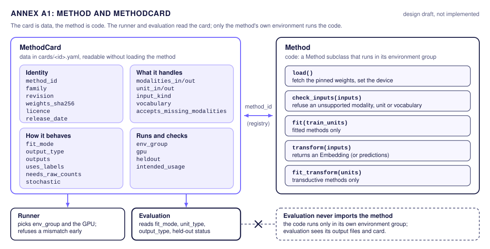
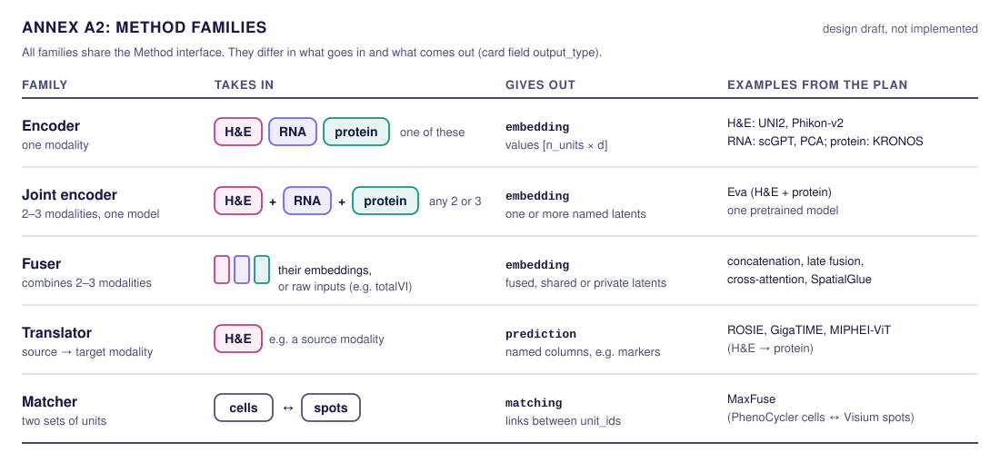
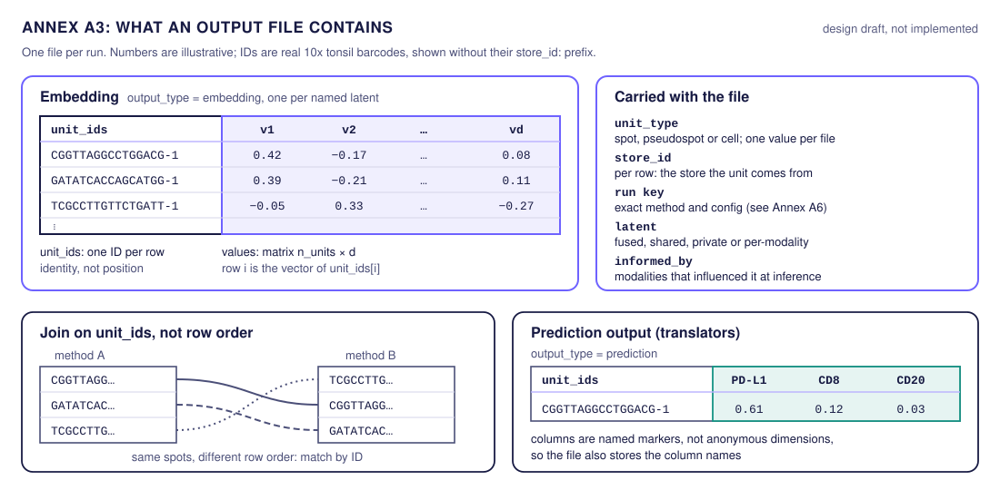
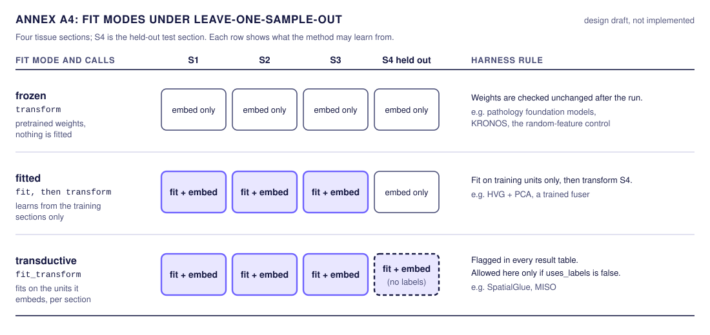
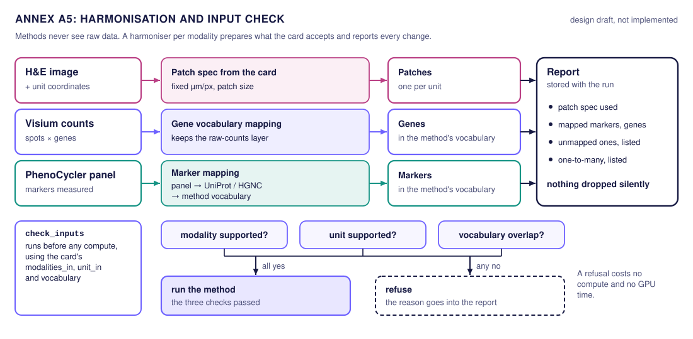
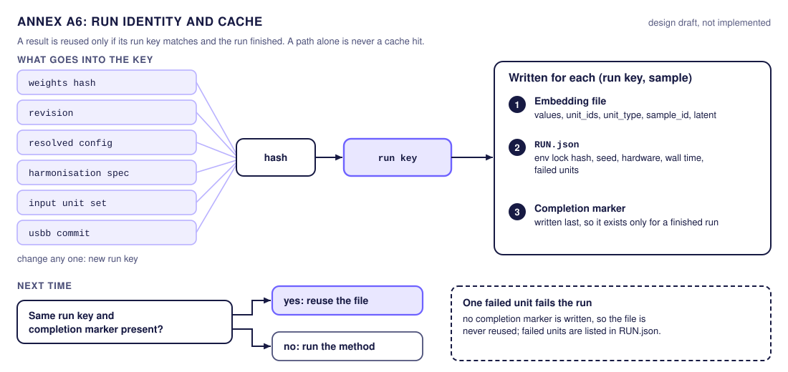

# Method wrappers

Draft v0, 2026-11-16, nothing implemented yet. Package `src/usbb`, branch `features/wrappers_raph`. Edit as we go; log at the bottom.
`[N:key]` = reading note on that benchmark, written during the survey (not yet re-checked line by line; available on request). `[P]` = our proposal, not from evidence.

## Goal

One object per method (encoder, translator, fuser, matcher) that can be **loaded**, **applied** to units (spot, pseudospot, cell), **read** in one standard output, and **identified** by a card. Unimodal and multimodal methods share one interface. Adding or removing a method touches one class, one card, one YAML. Evaluation is a separate layer that never imports a method.

**Figure 1.** Planned wrapper architecture (design draft). Wrappers write an `Embedding` file, a run record and the card; evaluation reads only those. Controls such as the random-feature encoder are ordinary registry entries and are not drawn separately. Annex figures A1–A6 at the end detail the parts that need it.

## Decisions (2026-11-16, Raphaël)

- Wrappers and evaluation separate; wrappers built with evaluation in mind.
- Layout: shared base + modality-specific + fusion-specific + harmonisation layer.
- `fit`/`transform` plus a `transductive` flag, and any further flag the evidence justifies.
- Per-method environments, grouped to keep their number low; runs are SLURM jobs on GPUs.
- Config in Python + YAML. v0 is a thin vertical slice.
- Data container (SpatialData / AnnData / own) not decided; settled together with the output format.

## Design [P]

**Card** (`cards/<id>.yaml`): `method_id`, `family`, pinned `revision` + `weights_sha256`, weights `licence`, `release_date`, `modalities_in/out`, `unit_in/out`, `input_kind` (raw | embeddings), `output_type` (embedding | prediction | matching), `outputs` (named latents, each with a `kind` and `informed_by`), `vocabulary`, `fit_mode`, `uses_labels`, `needs_raw_counts`, `stochastic`, `accepts_missing_modalities`, `env_group`, `gpu`, `heldout` per dataset (N | Y | ? | unknown), `intended_usage`.

**Classes:** `Method` → `Encoder` (`HE`, `RNA`, `Protein`, `Joint`), `Translator`, `Fuser`, `Matcher`. `Method` is the executable class; `MethodCard` is its static metadata (YAML), readable without loading weights or importing the method, which is what lets evaluation use it. `Joint` is one pretrained model that takes two or three modalities natively (e.g. Eva: H&E + protein); a `Fuser` combines per-modality embeddings (or raw inputs, e.g. totalVI) into one latent; a `Translator` maps a source modality to a target one. All take a mapping modality → harmonised input; a unimodal encoder declares one modality, a joint encoder or fuser two or three. A `Fuser` returns the fused latent together with its input embeddings and records its readout name in `RUN.json`, since reported scores vary by readout (thymus F1 0.309 to 0.384 in the SIS paper) [PAPER: Richter2026, SI p.8, p.10].

| `fit_mode` | Calls | Harness rule |
|---|---|---|
| `frozen` | `transform` | parameters checked unchanged after the run |
| `fitted` | `fit(train)` then `transform` | fit on training units only |
| `transductive` | `fit_transform` | flagged in results; `uses_labels` decides if allowed in leave-one-sample-out |

**Harmonisation layer:** per modality, turns data into what the card accepts and reports what it changed (H&E patch spec at fixed µm/px; RNA gene vocabulary and raw counts; protein panel → UniProt/HGNC → method vocabulary with unmapped and one-to-many rows listed). `check_inputs` refuses unsupported modality, unit or vocabulary before any compute.

**Output:** `Embedding` = values + `unit_ids` + `unit_type` + `sample_id` + `latent` + `informed_by` + run key, one file per (run, sample). A run can write several named latents on the same units (fused, shared, private, or a per-modality latent refined by the other modalities). `informed_by` lists the modalities that influenced a latent at inference, so evaluation can skip a probe target the latent has already seen. `unit_ids` has one entry per row of `values` (Visium barcode, pseudospot ID or cell ID); `unit_type` is one value per file (`spot`, `pseudospot` or `cell`). IDs travel with values; row order is never the link. Leading option: plain arrays + JSON sidecar at the boundary, converted to AnnData/SpatialData by the harness, because SpatialData 0.9.0 needs Python ≥ 3.12 while SpatialGlue pins `anndata==0.8.0` [N:data-format].

**Identity and cache:** run key = hash(weights hash, revision, config, harmonisation spec, input unit set, `usbb` commit). A cache hit needs the key and a completion marker, never a path alone. `RUN.json` adds env lock hash, seed, hardware, wall time, failed units. One failed unit fails the run.

**Environments:** `envs/groups.yaml` (group → methods, lock file, written reason for each exclusion). The runner calls `python -m usbb.cli run …` inside the group env; files in, files out; `usbb` core has minimal dependencies. One SLURM array job per (group, method, sample batch); resume skips units with key + marker.

**Evaluation seam:** reads `Embedding` files and cards, and uses `informed_by` to avoid probing a latent for something it was given. Owns splits, PCA to fixed dimension (train only), probes, patient-level bootstrap, checkpoint selection on validation. Controls (random-feature encoder, PCA, label-shuffle, section-identity probe) are registry entries.

**Tests:** one contract suite over the registry on tiny synthetic input: card validates, wrong modality refused, IDs and order kept, seed reproducible, frozen weights unchanged.

## Lessons from ten benchmark codebases

Gaps repeated almost everywhere, each of which the design above answers:
- Cache keyed by path or file existence, weights unpinned or unhashed [N:hest-benchmark, stp-bench, spora-bench, scfm-unified].
- No fit/transform separation; PCA fitted on all data including test [N:scib, spora-bench, scfm-unified].
- Checkpoints or genes selected on test data [N:stp-bench, hest-benchmark]; bootstrap over cells, not patients [N:spora-bench].
- "Frozen" claimed, never enforced [N:phenobench].
- Row order as the only link to cells; wrong order turned ARI 0.599 into 0.001 [N:integration-bench].
- Registries as `if/elif` chains; failures hidden under retry-then-ignore [N:hescape, exemplars].

Worth reimplementing: encoder `_build()` + factory [N:hest-benchmark]; mteb-style method card with held-out status that can say "unknown" [N:exemplars]; YAML method registry with modalities and output spec, run as subprocess per env (36 methods → 24 envs) [N:integration-bench]; declared `output_type` [N:scib]; three-layer marker harmonisation [N:spora-bench]; shortcut controls [N:scfm-unified].
Licences: HEST, TRIDENT, spora-bench, STP-Bench are non-commercial, so we read and reimplement. spora-io (MIT) is reusable.

## v0 slice

Random-feature control; ImageNet ResNet50 and one fetchable pathology foundation model (H&E); HVG + PCA (RNA); mean marker intensity (protein); concatenation. One sample of the 10x tonsil set, end to end as a SLURM job.

## Open questions

1. Data container and output format (field practice in [N:data-format]).
2. Who owns the base classes and each modality family.
3. Transductive methods in leave-one-sample-out: allowed if label-free and flagged?
4. Translators and matchers in the same hierarchy, or their own output family. A translator's `prediction` file needs named columns (markers), which the `Embedding` container does not have yet (Annex A3).
5. First pathology foundation model fetchable on the cluster; SLURM tooling and cache location; where the evidence notes live.
6. `pyproject.toml` still points at `src/model`.

## Annex

**A1. Method and MethodCard.** The card is data (YAML, readable without loading the method); the method is code. The runner and evaluation read the card, evaluation never imports the method.

**A2. Method families.** What each family takes in and gives out, with examples from the plan.

**A3. What an output file contains.** Values, unit IDs, unit type, sample and run key; joining by ID; prediction files with named columns. Numbers are illustrative.

**A4. Fit modes.** What frozen, fitted and transductive methods may learn from under leave-one-sample-out.

**A5. Harmonisation and input check.** Per-modality preparation, the report of changes, and the checks that run before any compute.

**A6. Run identity and cache.** What goes into the run key, what is written for each run, and when a result is reused.

## Log

| Date | Change |
|---|---|
| 2026-11-16 | Draft v0 |
| 2026-11-16 | Figure 1 (architecture overview) added |
| 2026-11-16 | Annex figures A1–A6 added; Figure 1 corrected (joint = any 2–3 modalities) |
| 2026-11-16 | Several named latents per run (`latent`, `informed_by`); figure font changed to Helvetica/Arial |
